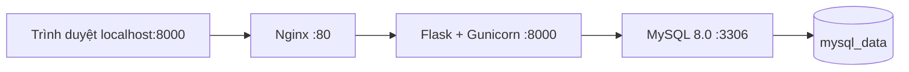

# Kiến trúc TechFlow

Giai đoạn 1 cung cấp Flask app factory, cấu hình, extensions, health check,
CLI kiểm tra database và Docker local. Giai đoạn 2 bổ sung 10 bảng nghiệp vụ,
migrations, seed và CLI Admin; xem [database](DATABASE.md). Giai đoạn 3 bổ sung
đăng nhập, phân quyền và layout Dashboard. Giai đoạn 4 bổ sung CRUD danh mục,
nhà cung cấp và sản phẩm trong Business workspace.

- Chỉ Nginx publish trên loopback của host. MySQL không publish cổng.
- `backend` là network nội bộ giữa web và db; `frontend` nối Nginx và web.
- DB health check chạy SELECT 1 bằng user ứng dụng; web đợi DB healthy.
- `/health` chỉ là liveness của Flask, không xác nhận kết nối database.
  `flask --app wsgi check-db` kiểm tra kết nối MySQL thật, trả exit code 1 khi lỗi.
- Không tạo bảng, seed hoặc migration tự động lúc worker khởi động.
- Timestamp database thống nhất UTC; giao diện tương lai định dạng theo Asia/Ho_Chi_Minh.
- Chưa bật ProxyFix; không tin forwarded headers từ request để quyết định bảo mật.

## Ranh giới trách nhiệm

`routes.py`: nhận request, kiểm tra quyền khi có auth, trả response.
`forms.py`: validation backend bằng WTForms, gồm LoginForm và các CatalogForm.
`services/`: nghiệp vụ và transaction; không phụ thuộc vào template.
`models/`: ORM và quan hệ, sẽ được import đầy đủ để Alembic phát hiện.
`templates/`, `static/`: giao diện và assets.
`extensions.py`: extensions chưa bind; bind trong `create_app()`.

Auth, dashboard, users, categories, businesses và products đã đăng ký route.
Purchases/sales và màn hình audit dành cho giai đoạn sau. Nhóm phát triển nhập kho và bán hàng
phải đặt transaction, khóa hàng và chống xử lý lặp trong services, không đặt trong route.

## Định hướng UI đã thống nhất

Giai đoạn 3 đã dùng Bootstrap 5 và Jinja2, sidebar navy, content sáng, accent xanh dương,
CSS tùy chỉnh, icon thống nhất và offcanvas mobile. Assets Bootstrap lưu nội bộ.
Trang `/` là thông tin nền tảng; `/login` dùng layout thương hiệu. `/dashboard`
chỉ chuyển tới `/admin/dashboard` hoặc `/staff/dashboard` theo vai trò đã xác thực.
Hai trang dùng `layouts/admin.html` và `layouts/staff.html`, có navigation và
Dashboard riêng. Cùng kế thừa `layouts/workspace.html` để dùng chung shell,
topbar, Logout, breadcrumb, flash và responsive. Macro navigation ở
`components/navigation.html`. CSS thương hiệu/Login ở `static/css/techflow.css`;
CSS workspace riêng ở `static/css/workspace.css`. Không copy layout Admin rồi ẩn
menu cho Staff. Admin được vào cả hai không gian, Staff chỉ Business. Trang lỗi
chọn layout theo vai trò và đường dẫn Business đang truy cập.
Không tạo liên kết hoặc nút nghiệp vụ trước khi chức năng hoạt động.

`users/routes.py` giữ Blueprint admin và route `/admin` tương thích bằng redirect
có admin_required. `dashboard/routes.py` giữ redirect cũ và route Staff, dùng
business_required (cho phép Admin và Staff). Cùng admin_required dùng chung
role_required; quyền được kiểm tra
trước render. `workspace_service.py` chỉ SELECT 1 cho trạng thái MySQL Admin;
không ghi dữ liệu và không mô phỏng giám sát Docker/AWS. Ngày trên Staff lấy từ
clock hệ thống, chuyển Asia/Ho_Chi_Minh. Chưa thêm bảng hoặc migration.

Workspace hiện tại tách khỏi role tài khoản: Admin xem Business vẫn role Admin,
layout Business và home/breadcrumb Business, có liên kết Quay về quản trị. Không
thay đổi session, CSRF hoặc dữ liệu user khi chuyển không gian.

Luồng xác thực, decorator quyền và cấu trúc mở rộng: [AUTHENTICATION.md](AUTHENTICATION.md).

## Module catalog — Giai đoạn 4

- `categories/routes.py`, `businesses/routes.py`, `products/routes.py` khai báo ba
  Blueprint riêng. `catalog/routes.py` tạo các route đồng nhất, kiểm tra quyền,
  tìm kiếm/lọc/phân trang và render; không chứa transaction ghi dữ liệu.
- `catalog/resources.py` định nghĩa model/form/nhãn/mã của từng module;
  `catalog/forms.py` validation theo schema và nạp lựa chọn FK từ database qua routes.
- `services/catalog_service.py` chỉ nhận các trường đã khai báo trong form,
  commit bản ghi và AuditLog cùng transaction; rollback cả hai nếu lỗi.
  Xóa sản phẩm khóa hàng để kiểm tra tồn kho; FK RESTRICT bảo vệ liên kết.
- `templates/catalog/` dùng layout Staff cho cả hai vai trò; `static/css/catalog.css`
  định dạng bảng/form/detail/modal và responsive. JS ngoài template xử lý modal/loading.
- Không thay models, migration hoặc service nhập/bán hàng. Không có trường form
  ghi `stock_quantity`. URL hình ảnh được kiểm tra, preview trên browser và có liên kết;
  ứng dụng không tải URL từ server. CSP chỉ mở img-src HTTP/HTTPS ở products theo
  xác nhận bổ sung của người dùng; script/style/font và các trang khác giữ nguyên.

Hợp đồng route, validation và bàn giao: [CATALOG.md](CATALOG.md).

## Dashboard chỉ đọc — Giai đoạn 6 giữa kỳ

`dashboard/routes.py` giữ route `/staff/dashboard`, dùng role tài khoản từ
Flask-Login và gọi `services/dashboard_service.py`. Service dùng một connection/
transaction đọc mới để các aggregate và danh sách cùng snapshot MySQL. Sáu SELECT
trả aggregate, top danh mục, 8 cảnh báo và 6 sản phẩm gần đây; không ORM lazy-load
hay đọc toàn bộ lịch sử vào memory, không truy vấn phiếu nhập/đơn bán/audit/user.
Service kiểm tra role và chỉ truy vấn SUM theo giá nhập cho Admin.

`templates/staff/dashboard.html` kế thừa `dashboard/business.html`, tiếp tục dùng
layout Staff hiện tại. `static/css/dashboard.css` chỉ áp dụng component Dashboard;
`static/js/dashboard.js` dựng Chart.js UMD nội bộ, không inline script/CDN/API mới.
Bảng HTML là nguồn đọc thay thế cho canvas. Base thêm block extra_js để trang
khác không phải tải thư viện biểu đồ. Thông tin phiên `#session` giữ nguyên.

Models/migrations/seed/tồn kho và Dashboard hệ thống Admin không thay đổi.
Chi tiết phạm vi, công thức và giới hạn index: [DASHBOARD.md](DASHBOARD.md).
