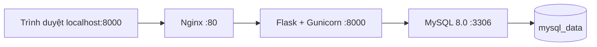

# Kiến trúc TechFlow

Giai đoạn 1 cung cấp Flask app factory, cấu hình, extensions, health check,
CLI kiểm tra database và Docker local. Giai đoạn 2 bổ sung 10 bảng nghiệp vụ,
migrations, seed và CLI Admin; xem [database](DATABASE.md). Giai đoạn 3 bổ sung
đăng nhập, phân quyền và layout Dashboard; chưa triển khai CRUD.

- Chỉ Nginx publish trên loopback của host. MySQL không publish cổng.
- `backend` là network nội bộ giữa web và db; `frontend` nối Nginx và web.
- DB health check chạy SELECT 1 bằng user ứng dụng; web đợi DB healthy.
- `/health` chỉ là liveness của Flask, không xác nhận kết nối database.
  `flask --app wsgi check-db` kiểm tra kết nối MySQL thật, trả exit code 1 khi lỗi.
- Không tạo bảng, seed hoặc migration tự động lúc worker khởi động.
- Timestamp database thống nhất UTC; giao diện tương lai định dạng theo Asia/Ho_Chi_Minh.
- Chưa bật ProxyFix; không tin forwarded headers từ request để quyết định bảo mật.

## Ranh giới trách nhiệm

`routes.py`: nhận request, kiểm tra quyền khi có auth, trả response.
`forms.py`: validation backend bằng WTForms, hiện có LoginForm.
`services/`: nghiệp vụ và transaction; không phụ thuộc vào template.
`models/`: ORM và quan hệ, sẽ được import đầy đủ để Alembic phát hiện.
`templates/`, `static/`: giao diện và assets.
`extensions.py`: extensions chưa bind; bind trong `create_app()`.

Auth, dashboard và users đã đăng ký route. Categories/businesses/products/purchases/
sales/audit dành cho giai đoạn sau. Nhóm phát triển nhập kho và bán hàng
phải đặt transaction, khóa hàng và chống xử lý lặp trong services, không đặt trong route.

## Định hướng UI đã thống nhất

Giai đoạn 3 đã dùng Bootstrap 5 và Jinja2, sidebar navy, content sáng, accent xanh dương,
CSS tùy chỉnh, icon thống nhất và offcanvas mobile. Assets Bootstrap lưu nội bộ.
Trang `/` là thông tin nền tảng; `/login` dùng layout thương hiệu và `/dashboard`
dùng `templates/layouts/admin.html`. CSS chung ở `static/css/techflow.css`.
Không tạo liên kết hoặc nút nghiệp vụ trước khi chức năng hoạt động.

Luồng xác thực, decorator quyền và cấu trúc mở rộng: [AUTHENTICATION.md](AUTHENTICATION.md).
