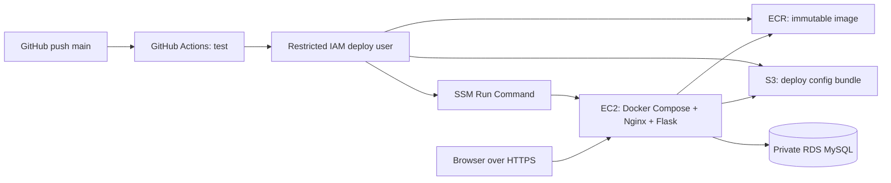

# Chuẩn bị triển khai AWS: EC2 + RDS + GitHub Actions

Tài liệu này mô tả workflow deploy cho ứng dụng đang chạy trên EC2, RDS và S3 tại
`ap-southeast-2`, với domain `techflow223.duckdns.org`. Workflow deploy vẫn bị khóa
cho tới khi `AWS_DEPLOY_ENABLED=true` và các quyền bên dưới đã được cấu hình.

## Kiến trúc



RDS chỉ nhận MySQL từ security group của EC2. ECR lưu image; S3 chỉ lưu file
Compose/Nginx theo mã release; EC2 lấy image và bundle qua IAM role. Workflow dùng
IAM user access key từ GitHub Environment Secrets vì tài khoản chưa cấu hình được
OIDC. Đây là credential dài hạn: giới hạn quyền vào tài nguyên TechFlow, không dùng
root, định kỳ xoay vòng và thu hồi key khi không còn dùng. `.env.production` ở máy
EC2 không được đưa vào Git, image hoặc bundle.

## Trước khi bật deploy tự động

1. Trong AWS Billing, xác nhận $100 credit còn hiệu lực, ngày hết hạn và dịch vụ
   đủ điều kiện. Credit không phải giới hạn chi tiêu.
2. Dùng [AWS Pricing Calculator](https://calculator.aws/) để ước tính EC2, RDS,
   EBS, địa chỉ IPv4, ECR, S3, backup và data transfer tại `ap-southeast-2`.
   RDS và ổ đĩa có thể tiếp tục tính phí ngay cả khi EC2 dừng.
3. Tạo AWS Budget với cảnh báo mức sử dụng/chi phí; cảnh báo không tự dừng tài
   nguyên.
4. Có domain và trỏ bản ghi DNS tới địa chỉ EC2 ổn định. Không có domain thì
   chưa lấy được chứng chỉ TLS theo luồng Nginx/Let's Encrypt bên dưới. Có thể
   chuẩn bị CI, nhưng không cho người dùng đăng nhập qua HTTP.

## Tài nguyên cần tạo (thực hiện thủ công trong AWS Console)

Giữ các tài nguyên ứng dụng trong cùng Region `ap-southeast-2` (Sydney).

1. **VPC/network:** dùng VPC có EC2 ở subnet public và RDS ở subnet private.
   Không tạo NAT Gateway chỉ để nối EC2/RDS; NAT có thể phát sinh chi phí. EC2
   cần outbound Internet để lấy image khi dùng public IPv4.
2. **Security group EC2:** inbound TCP 80/443 từ Internet. Quản trị qua SSM
   Session Manager; nếu cần SSH tạm thời, chỉ cho IP của bạn, không mở `22` cho
   toàn Internet. Không mở 8000.
3. **EC2:** Amazon Linux 2023, kiến trúc `x86_64`, disk EBS vừa đủ. Gắn instance
   profile cho SSM, pull ECR image và đọc object trong prefix deploy của bucket.
   Cài Docker Engine/Compose plugin từ tài liệu Docker chính thức.
4. **RDS for MySQL:** chọn phiên bản MySQL 8.0 được RDS hỗ trợ, Single-AZ cho
   demo, database `tech_business_db`, private access, backup retention phù hợp.
   Không bật public access. RDS security group chỉ nhận TCP 3306 từ security
   group EC2. Tạo user ứng dụng riêng, không dùng master user cho app.
5. **ECR:** tạo private repository `techflow-web`, bật tag immutability nếu muốn
   khóa image theo commit SHA.
6. **S3:** tạo private bucket riêng cho deploy bundle; bật block public access,
   encryption, versioning tùy nhu cầu và lifecycle rule dọn release cũ.
7. **IAM cho GitHub Actions:** tạo IAM user riêng cho deploy, không bật AWS Console
   access. Gắn policy tối thiểu để push image vào đúng ECR repository, `PutObject`
   trong prefix `releases/*`, và gọi/đọc trạng thái SSM cho đúng instance. Tạo
   access key riêng cho user này; lưu `AWS_ACCESS_KEY_ID` và
   `AWS_SECRET_ACCESS_KEY` trong GitHub Environment `production`, không commit
   vào repo hay gửi qua chat.
8. **IAM cho EC2:** `AmazonSSMManagedInstanceCore` cùng quyền tối thiểu ECR pull và
   `GetObject` trong prefix deploy bucket. Không nhúng access key vào EC2.

AWS khuyến nghị giới hạn cổng RDS bằng security group và cho EC2 truy cập từ
security group của ứng dụng; RDS private không có public IP.
[Kết nối EC2/RDS](https://docs.aws.amazon.com/AmazonRDS/latest/UserGuide/ec2-rds-connect.html)

## Cấu hình ứng dụng trên EC2

Tạo thư mục `/opt/techflow/nginx`, `/etc/techflow` và file
`/etc/techflow/app.env` bằng phương thức không ghi secret vào shell history/log.
Tạo secrets độc lập, mạnh (có thể dùng `openssl rand -hex 32`); file chỉ đọc
được bởi root, ví dụ `chmod 600`.
Không dùng `.env` local, password demo hoặc nội dung trong `.env.production.example`
như credential thật.

Các biến cần có trong `app.env`:

```dotenv
APP_IMAGE=<ECR image URI with a commit SHA tag>
SECRET_KEY=<random secret, at least 32 characters>
MYSQL_DATABASE=tech_business_db
MYSQL_USER=<application database user>
MYSQL_PASSWORD=<application database password>
DB_HOST=<private RDS endpoint, hostname only>
DB_PORT=3306
LOG_LEVEL=INFO
TZ=Asia/Ho_Chi_Minh
```

Compose tạo URL MySQL an toàn từ các biến thành phần, vì vậy không cần ghi
`DATABASE_URL` hoặc URL-encode password. Bảo đảm RDS đã tạo database/user và
security group cho phép EC2 kết nối trước khi deploy.

## HTTPS lần đầu

Đợi DNS của domain trỏ tới EC2 trước khi yêu cầu Let's Encrypt. Trước lần deploy
đầu, bật SSH tạm thời chỉ từ IP của bạn hoặc dùng cách chuyển file đã được tổ
chức phê duyệt. Chuyển `docker-compose.prod.yml`, `docker-compose.bootstrap.yml`,
`.env.production.example`, `nginx/bootstrap.conf` và `nginx/prod.conf` từ checkout
đã review vào `/opt/techflow`; không chuyển file `.env` local. Tạo
`/etc/techflow/app.env` riêng bằng secrets production. Bootstrap Nginx
chỉ phục vụ ACME challenge và `/health`; các URL còn lại trả 503, không có trang
login qua HTTP.

```bash
cd /opt/techflow
docker compose --env-file /etc/techflow/app.env \
  -f docker-compose.prod.yml -f docker-compose.bootstrap.yml up -d nginx
docker compose --env-file /etc/techflow/app.env \
  -f docker-compose.prod.yml --profile certbot run --rm certbot certonly \
  --webroot -w /var/www/certbot --cert-name techflow \
  -d <your-domain> --email <your-email> --agree-tos --no-eff-email
```

Sau khi certbot thành công, file chứng chỉ nằm trong named volume `letsencrypt`.
Workflow deploy sẽ cập nhật file Nginx TLS và khởi động dịch vụ production. Nginx
redirect HTTP sang HTTPS, thêm HSTS và giữ giới hạn POST login. Thiết lập lịch
`certbot renew` định kỳ trên EC2 và reload Nginx sau khi gia hạn; kiểm tra quy
trình gia hạn trước khi dùng thật.

## GitHub Actions

Repository variables (không phải secrets) trong Settings → Secrets and variables
→ Actions → Variables:

| Variable | Giá trị |
| --- | --- |
| `AWS_DEPLOY_ENABLED` | để `false`/chưa đặt cho tới khi cấu hình xong HTTPS |
| `AWS_REGION` | `ap-southeast-2` |
| `ECR_REPOSITORY` | `techflow-web` |
| `EC2_INSTANCE_ID` | ID instance production |
| `DEPLOY_BUCKET` | tên bucket private |

Tạo Environment `production` trong Settings → Environments. Thêm hai Environment
secrets sau trong environment này; deploy job đã gắn với environment `production`:

| Secret | Giá trị |
| --- | --- |
| `AWS_ACCESS_KEY_ID` | Access key ID của IAM user deploy |
| `AWS_SECRET_ACCESS_KEY` | Secret access key của IAM user deploy |

`.github/workflows/ci.yml` chạy test Docker biệt lập trên pull request.
`.github/workflows/deploy.yml` chạy test trên main, rồi chỉ khi
`AWS_DEPLOY_ENABLED=true` mới build image theo commit SHA, đẩy lên ECR, lưu bundle
vào S3 và yêu cầu EC2 deploy qua SSM. Migrations chạy trước khi recreate app.
Không chạy `seed-demo` trên RDS production. Workflow kiểm tra `/health` sau deploy.
Trước khi bật deploy, cấu hình SSM và chứng chỉ TLS; workflow gửi Compose/Nginx
config mới tới EC2 theo từng release.

Sau khi kiểm tra DNS/HTTPS, quyền IAM, RDS connectivity, backup và budget, đặt
`AWS_DEPLOY_ENABLED=true` để bật deploy. Việc này là bước công khai/production,
không tự thực hiện trong quá trình chuẩn bị local.

## Giới hạn và vận hành

- Hiện chưa tạo EC2/RDS/ECR/S3/IAM, chưa có domain, chưa push branch hoặc bật
  workflow deploy.
- Trước migration quan trọng, tạo và xác minh backup RDS. Không chạy
  `docker compose down -v` trên production.
- Tạo Admin production qua SSM sau khi HTTPS hoạt động; nhập password qua prompt
  ẩn, không đặt `TECHFLOW_ADMIN_PASSWORD` trong command, workflow hoặc log.
- Kiểm tra chi phí sau khi tạo; dừng EC2 không xóa EBS/RDS/S3 và không đồng nghĩa
  ngừng toàn bộ chi phí. Xóa tài nguyên chỉ sau khi xác nhận backup và dữ liệu.
