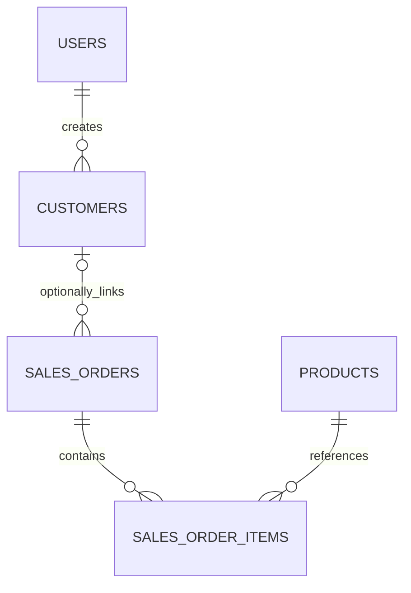

# Khách hàng và lịch sử mua hàng — Giai đoạn 5.1

Module bổ sung do nhóm duyệt, giữ Flask/Jinja2/Bootstrap 5/MySQL/Docker.
Branch `feature/stage-5-1-customers` dựa trên Stage 5 `c4320cf`; không merge main.

## Dữ liệu và định danh

`customers`: id BIGINT UNSIGNED, name VARCHAR(150), phone VARCHAR(16) UNIQUE,
email VARCHAR(190), address VARCHAR(255), is_active, created_by FK users,
created_at/updated_at UTC. Index name/is_active/created_by. Name/email không unique.
Tên bắt buộc, điện thoại bắt buộc; email/địa chỉ tùy chọn. Không có ghi chú nội bộ
trong hồ sơ khách; chỉ lưu thông tin cần để bán hàng.

Chuẩn hóa bỏ khoảng trắng và dấu phân cách `()-.`, chấp nhận dạng nội địa 0…
(10–11 chữ số) hoặc +84…/84… tương ứng, lưu +84… thống nhất. Đây là kiểm tra
định dạng cho dự án, không xác minh quyền sở hữu hoặc nhà mạng/số đang tồn tại.
Không nhận số quốc tế ngoài Việt Nam trong hồ sơ. Số vãng lai giữ validation
giao dịch hiện có, không áp dụng UNIQUE hoặc tự liên kết hồ sơ.

UNIQUE áp dụng cả hồ sơ inactive, xử lý xung đột tại MySQL kể cả hai request
đồng thời. Không tự gộp theo tên/phone/email. Trùng số trả 409 và hướng dẫn chọn
hồ sơ sẵn có hoặc bán vãng lai nếu hai người dùng chung số. Admin được sửa số
chưa sử dụng, kích hoạt/vô hiệu hóa; không cung cấp hard delete.

`sales_orders.customer_id` nullable FK RESTRICT. Index customer_id và composite
(customer_id,status,order_date). Không cascade-delete đơn hoặc hồ sơ. Đơn cũ
giữ NULL, không backfill. Bốn trường customer_* trên đơn là snapshot độc lập.
Tên/SKU sản phẩm vẫn lấy catalog hiện tại theo Stage 5; unit_price/quantity/
line_total là dữ liệu giao dịch snapshot, không tính lại theo giá bán hiện tại.



## Quyền và routes

| Route/chức năng | Admin | Staff |
| --- | --- | --- |
| GET /business/customers, /search, /<id> | Có | Có |
| /new, /<id>/edit | Có | 403 |
| POST /<id>/activate, /deactivate | Có | 403 |
| Tạo khách trong POST đơn bán | Có | Có |
| Lịch sử hồ sơ | Mọi trạng thái | Chỉ completed toàn cửa hàng |
| Mở/thao tác đơn của người khác | Theo quyền Stage 5 | 404, không mở quyền mới |

Staff xem name/phone/email/address phục vụ liên hệ, các dòng sản phẩm, giá,
ngày/mã đơn và thống kê completed. Không trả ghi chú nội bộ/audit từ history;
không có link mở đơn khác owner. Service history chọn projection rõ ràng,
không serialize toàn bộ SalesOrder. Query status/owner dùng current_user,
không nhận role hoặc created_by từ browser. Profile/history vẫn xem được khi
khách inactive, nhưng không chọn cho đơn mới. Đơn đã tạo vẫn xử lý theo Stage 5.

## Luồng lập đơn

1. **Khách vãng lai** (mặc định): nhập snapshot, customer_id luôn NULL dù phone
   trùng hồ sơ hoặc request cố gửi một customer_id.
2. **Chọn khách đã có hồ sơ**: tìm tên/số, chủ động chọn kết quả; xem lịch sử
   trong tab khác trước khi lưu. Backend khóa/đọc lại hồ sơ active và snapshot
   thông tin MySQL; không tin trường liên hệ tự điền từ browser.
3. **Tạo hồ sơ khách mới**: nhập thông tin liên hệ trong form đơn; customer,
   draft order, items và audit cùng Session/transaction. Lỗi bất kỳ rollback
   toàn bộ. Không để customer mồ côi sau khi tạo đơn lỗi.

Tạo draft không đổi kho. Confirm/cancel/row locks và snapshot giá Stage 5 giữ
nguyên. Customer locks trước product locks khi tạo đơn; sửa hồ sơ chỉ khóa
customer, không khóa order/product; không tạo vòng khóa ngược mới. UNIQUE phone
chặn duplicate race, signed order ticket và UNIQUE order_code giữ chống gửi lặp.
Audit chỉ ghi action/entity/id, không ghi giá trị phone/email/address/tên.
Nginx access log dùng `$uri`, không query/referrer để tránh ghi từ khóa liên hệ.

Không JavaScript: chọn 20 khách active đầu hoặc mở hồ sơ từ danh sách rồi
**Lập đơn cho khách** để chọn khách ngoài 20 dòng đầu. Inline new/walk-in vẫn
hoạt động, backend tự đọc/tính lại. Tìm kiếm gợi ý và nhiều dòng sản phẩm cần JS.

## Thống kê

- Số đơn: COUNT sales_orders WHERE customer_id=:id AND status='completed'.
- Chi tiêu: SUM(total_amount) cùng điều kiện; không float, mặc định Decimal 0.
- Lần mua gần nhất: MAX(order_date) của completed. Đây là **ngày lập đơn**,
  schema chưa có completed_at; không trình bày như thời điểm xác nhận.
- Sản phẩm từng mua: SUM quantity/line_total chỉ từ các đơn completed.
- Hủy completed làm đơn rời thống kê ngay; không tính draft/cancelled/vãng lai.
- History 10 đơn/trang và tổng hợp sản phẩm 10 dòng/trang, không tải toàn bộ
  lịch sử vào memory hoặc join làm nhân đôi SUM(total_amount).

## Migration, backup và kiểm thử

Migration `c051_customers` nối `db55d828848e`: tạo customers, thêm FK nullable
và indexes. Không sửa snapshot/stock/trạng thái/tiền, không xóa probe. MySQL DDL
có thể chờ metadata lock và không rollback như nghiệp vụ; nâng cấp khi dừng ghi.
Downgrade tự động bị chặn vì sẽ mất hồ sơ/liên kết. Khi cần rollback ứng dụng,
giữ schema bổ sung tương thích code Stage 5; khôi phục DB/forward fix cần kế
hoạch được duyệt, không tự ghi đè dữ liệu phát sinh.

```powershell
docker compose -f docker-compose.db-test.yml run --build --rm tests
.\.venv\Scripts\python.exe scripts/verify_customer_migration.py
.\.venv\Scripts\python.exe scripts/backup_before_customers.py
docker compose -f docker-compose.db-test.yml --profile ui up -d --wait ui-nginx
docker compose -f docker-compose.db-test.yml exec -T ui-nginx nginx -s reload
.\.venv\Scripts\python.exe scripts/verify_customers_ui.py
```

Migration helper tạo schema test mới cho rỗng/legacy, không reset/drop schema
cũ. Backup helper dành cho schema demo **trước** migration: dump chỉ đọc vào
ignored `.docker-local/backups`, khôi phục vào schema db-test mới và so 12 bảng.
Backup chứa dữ liệu/tài khoản hash, chỉ giữ local, không commit/chia sẻ công khai.
File SQL không chứa lệnh tạo/đổi database demo, restore chỉ hướng tới schema test.
Chạy các suite tuần tự; giãn thời gian để tôn trọng limiter đăng nhập.

Chưa có merge hồ sơ, bulk import/export, gán lại đơn cũ, xác minh OTP, giảm giá,
điểm/thành viên, xếp hạng hoặc AWS. Kết quả nghiệm thu:
[Giai đoạn 5 — Khách hàng và lịch sử mua](STAGE_5_REPORT.md#khach-hang).
