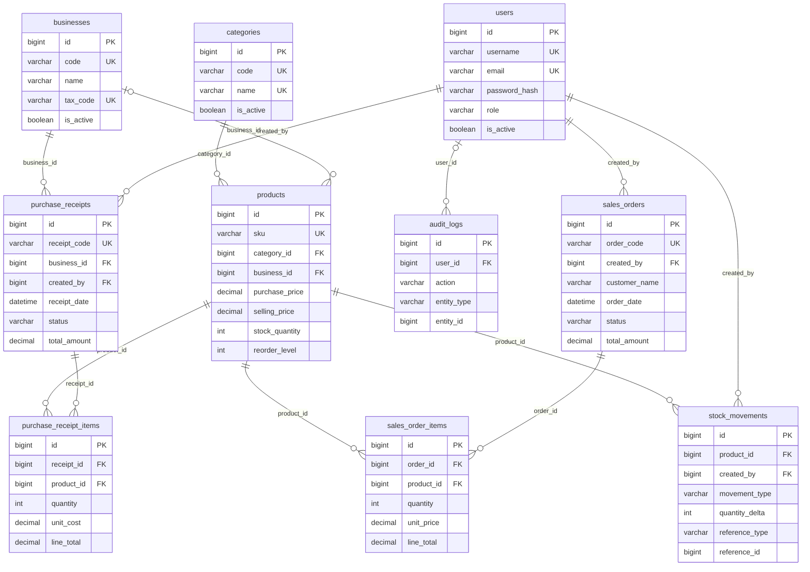

# Mô hình database TechFlow

Schema hiện tại Giai đoạn 5.1 có **11 bảng nghiệp vụ, 14 khóa ngoại**;
migration `c051_customers` thêm customers và customer_id nullable vào đơn bán.
ERD và quy tắc snapshot/identity: [CUSTOMERS.md](CUSTOMERS.md).
Phần dưới ghi baseline Giai đoạn 2; schema đầy đủ hiện tại ở DATABASE_SCHEMA.md.

Giai đoạn 2 dùng MySQL 8.0.44, Flask-SQLAlchemy và Alembic. Có **10 bảng nghiệp vụ,
12 khóa ngoại**; `alembic_version` là bảng kỹ thuật, `stage1_probe` là bảng kiểm tra
được giữ nguyên và nằm ngoài metadata nghiệp vụ.

| Bảng | Chức năng | Unique |
| --- | --- | --- |
| users | Tài khoản admin/staff, mật khẩu scrypt | username, email nullable |
| businesses | Nhà cung cấp | code, tax_code nullable |
| categories | Danh mục | code, name |
| products | Sản phẩm, giá và tồn kho hiện tại | sku |
| purchase_receipts | Header phiếu nhập | receipt_code |
| purchase_receipt_items | Dòng phiếu nhập | PK id |
| sales_orders | Header đơn bán, snapshot khách hàng | order_code |
| sales_order_items | Dòng đơn bán, snapshot đơn giá | PK id |
| stock_movements | Lịch sử tăng/giảm kho | PK id |
| audit_logs | Nhật ký hành động | PK id |

Chi tiết toàn bộ cột, kiểu, nullable, index và constraints:
[DATABASE_SCHEMA.md](DATABASE_SCHEMA.md), được xuất từ metadata models.

## ERD

## Ràng buộc và quy ước

- Tất cả PK/FK dùng BIGINT UNSIGNED tương thích; quantity và reorder_level dùng
  INT UNSIGNED. `quantity_delta` dùng INT có dấu để mô tả nhập/xuất tương lai.
- InnoDB, utf8mb4_unicode_ci trên cả 10 bảng. So sánh unique không phân biệt
  hoa/thường và theo quy tắc dấu của collation. Category name unique là quyết định
  chống trùng của MVP; chuẩn hóa trim trong form sẽ bổ sung ở giai đoạn 4.
- Tiền DECIMAL(14,2), Python Decimal. CHECK chặn giá âm, số lượng dòng bằng 0,
  tổng dòng không bằng quantity × unit_cost/unit_price, role/status/type ngoài danh sách.
- FK đều ON DELETE RESTRICT; ORM dùng passive_deletes='all' trên collections để
  không tự cascade hoặc null hóa quan hệ khi xóa parent, kể cả relation đã load.
- business_id của sản phẩm, email user, tax_code và user_id audit có thể null.
  MySQL cho phép nhiều giá trị NULL trong unique index.
- Mọi bảng có created_at UTC; 6 bảng mutable có updated_at được ORM cập nhật.
  Các dòng giao dịch, stock movement, audit chỉ có created_at đúng đặc tả.
  Kết nối MySQL đặt session time_zone='+00:00'. SQL viết ngoài ORM cần tự cập nhật updated_at.
- Các index theo FK, tên/trạng thái sản phẩm, trạng thái/ngày giao dịch và composite
  reference/entity hỗ trợ truy vấn tiếp theo. SKU/mã unique được index bởi database.
- `stock_movements.reference_id` và `audit_logs.entity_id` là tham chiếu đa loại,
  không phải FK cứng. Các service tương lai phải kiểm tra đối tượng tham chiếu.
- Schema không tự chuyển trạng thái, tính tổng header, cập nhật tồn kho hoặc sinh
  movement. Những quy tắc transaction này thuộc giai đoạn nghiệp vụ sau giữa kỳ.
- Lịch sử kho/audit không có endpoint chỉnh sửa hoặc xóa. Tính append-only hiện là
  quy ước ứng dụng; chưa có DB trigger ngăn người dùng SQL trực tiếp sửa lịch sử.

## Migrations và bảo toàn dữ liệu

Revision khởi tạo: `db55d828848e`; upgrade chỉ tạo 10 bảng cùng indexes/constraints.
Chạy `flask --app wsgi db upgrade` thủ công, không chạy từ startup workers.
`app/migration_policy.py` bảo vệ stage1_probe và không đề xuất drop bảng reflected
ngoài metadata. Bảng probe vẫn được giữ nguyên qua upgrade và schema comparison.

MySQL DDL không rollback toàn bộ như transaction DML; nếu upgrade bị gián đoạn,
cần kiểm tra trạng thái trước khi chạy lại. Không stamp để bỏ qua schema lỗi.
Downgrade có trong revision chuẩn nhưng có thể xóa bảng/dữ liệu nghiệp vụ;
chưa chạy downgrade và không dùng nó trên database demo hiện tại.

## Seed demo và Admin

`seed-demo` chỉ chạy development/testing, tạo 6 danh mục, 6 nhà cung cấp và 36
sản phẩm giả lập. Mã dùng prefix DEMO; email dùng example.invalid. Seed chỉ thêm
bản ghi thiếu theo code/SKU, không ghi đè tên, giá, trạng thái hoặc tồn kho đã sửa.
Toàn bộ seed nằm trong một transaction; khi lỗi rollback và báo lỗi an toàn.

Tất cả tồn kho seed bằng 0; không có phiếu nhập/đơn bán/movement/doanh thu giả.
Dashboard giữa kỳ sẽ phản ánh tình trạng này khi được triển khai. Seed không tạo
tài khoản/mật khẩu mặc định. Admin được tạo bằng CLI riêng, mật khẩu nhập ẩn hai
lần hoặc lấy từ TECHFLOW_ADMIN_PASSWORD trong môi trường được cấp có kiểm soát.
CLI không nhận password qua argument, không in mật khẩu, không ghi đè tài khoản trùng;
thêm user và audit log trong một transaction. Mật khẩu dài 12–128 ký tự, hash scrypt.

## Kiểm thử MySQL

Project `techflow-db-tests`, database `techflow_test`, user `techflow_test_user`,
network `test-backend` và volume riêng. Không publish MySQL test ra host. Fixtures
chỉ chấp nhận host db-test và database techflow_test. Migration được chạy trước pytest;
không dùng create_all/drop_all. Dữ liệu test có mã ngẫu nhiên và được giữ trong volume
test; chạy lại không yêu cầu reset/xóa volume. Dừng service test khi xong để tiết kiệm RAM.
