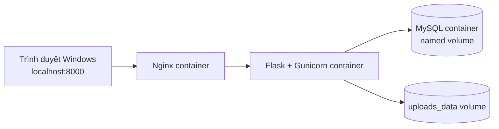
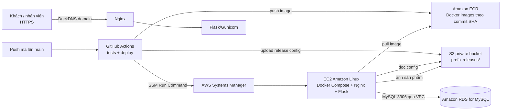

# TechFlow: dự án và hành trình đưa ứng dụng lên AWS

> Tài liệu giải thích dự án cho người mới đọc và hỗ trợ thuyết trình. Nội dung được tổng hợp từ mã nguồn, cấu hình triển khai và các log bạn đã cung cấp. Trạng thái vận hành được ghi theo thông tin có tại ngày **11/10/2026**; các bước chưa có log xác nhận được đánh dấu rõ.

## 1. Tóm tắt nhanh

TechFlow là ứng dụng web quản lý cửa hàng thiết bị công nghệ. Ứng dụng được viết bằng **Python Flask**, giao diện **Jinja2/Bootstrap**, dữ liệu quan hệ lưu trong **MySQL**. Dự án bắt đầu chạy local bằng Docker Compose trên máy Windows, sau đó được đưa lên AWS: EC2 chạy Docker Compose và Nginx, RDS lưu MySQL, S3 lưu ảnh sản phẩm và gói cấu hình phát hành, ECR lưu Docker image. GitHub Actions kiểm tra mã và triển khai qua AWS Systems Manager (SSM).

Mục tiêu học tập không chỉ là “đưa website lên mạng”, mà còn thực hành các ý tưởng điện toán đám mây: tách lớp ứng dụng và dữ liệu, mạng và firewall, IAM least privilege, lưu file bền vững, HTTPS, migration database và tự động hóa phát hành.

**Một câu mô tả để mở đầu khi thuyết trình:**

> “Em xây dựng TechFlow bằng Flask để quản lý sản phẩm, kho và đơn hàng; sau đó đóng gói ứng dụng bằng Docker, dùng EC2 để chạy web, RDS để quản lý MySQL, S3 để lưu ảnh, ECR để lưu image và GitHub Actions kết hợp SSM để triển khai lên EC2.”

## 2. Ứng dụng giải quyết việc gì?

TechFlow có ba vai trò tài khoản, được kiểm tra ở phía server chứ không chỉ ẩn menu trên giao diện:

| Vai trò | Công việc chính |
| --- | --- |
| **Admin** | Quản lý hệ thống, danh mục, nhà cung cấp, sản phẩm; xử lý nhập kho/bán hàng; xem khách hàng và thống kê; tạo, kích hoạt hoặc vô hiệu hóa tài khoản Staff. |
| **Staff** | Làm nghiệp vụ cửa hàng được cấp quyền, như quản lý catalog và xử lý đơn online; không truy cập trang quản trị Admin. |
| **Client** | Tìm kiếm/lọc/sắp xếp sản phẩm, xem chi tiết, dùng giỏ hàng, đăng ký/đăng nhập, cập nhật thông tin giao hàng và xem đơn của chính mình. |

Đơn hàng online hiện là **yêu cầu đặt hàng**: khách không thanh toán trực tuyến. Đơn bắt đầu ở trạng thái chờ/draft; nhân viên xác nhận và xử lý theo nghiệp vụ. Tồn kho và giá được kiểm tra lại trong transaction khi xử lý. Đây là cách giới hạn phạm vi đồ án và tránh giả lập một tích hợp thanh toán chưa có.

Các phần nghiệp vụ đã có trong dự án gồm catalog, nhập/bán và lịch sử kho, khách hàng, bảo hành, dashboard thống kê. Quyền ở route và service bảo vệ dữ liệu; password được lưu dạng hash, thao tác có CSRF và audit ở các luồng phù hợp. Chi tiết role có trong [role-permissions.md](role-permissions.md).

## 3. Kiến trúc tổng thể

### 3.1 Chạy local trên máy Windows

Docker Desktop dùng Linux Engine qua WSL 2. Docker Compose tạo ba service:



- Trình duyệt chỉ truy cập Nginx ở `localhost:8000`; Gunicorn và MySQL không mở trực tiếp ra Internet.
- MySQL lưu data trong Docker named volume, vì vậy dữ liệu còn sau khi container được tạo lại.
- Ảnh local nằm trong volume riêng. Local dùng cùng cấu trúc ứng dụng nhưng không cần AWS.
- Migration chạy rõ ràng bằng Flask-Migrate/Alembic; việc khởi động container không tự ý tạo bảng hoặc seed dữ liệu.

### 3.2 Môi trường AWS



Trong AWS, RDS là database riêng, không chạy chung trong EC2 và không mở công khai. EC2 kết nối tới RDS bằng mạng VPC/security group. Nginx nhận HTTP/HTTPS công khai và proxy request vào web container; cổng Gunicorn 8000 không công khai. EC2 gọi S3/ECR bằng **instance role**, không nhúng access key AWS vào file cấu hình ứng dụng.

Các tài nguyên được tạo trong region **Asia Pacific (Sydney), `ap-southeast-2`**. Tài khoản/project hiện được AWS gán region này; console báo không thể chuyển sang region thương mại khác nếu chưa kích hoạt tính năng nâng cao. Dùng region được cấp giúp giữ các dịch vụ cùng khu vực và tránh phải đổi endpoint/IAM/network giữa chừng.

## 4. Dịch vụ và công nghệ: dùng gì, dùng để làm gì?

| Công nghệ/dịch vụ | Vai trò trong dự án | Vì sao chọn |
| --- | --- | --- |
| **Flask + Python** | Web app, routes, validation, authentication và nghiệp vụ | Nhẹ, phù hợp đồ án; dễ tách routes, forms, services và models để giải thích. |
| **SQLAlchemy + Alembic/Flask-Migrate** | ORM và version hóa schema database | Thay đổi schema có migration có thể review, áp dụng local trước rồi mới chạy production. Tránh phải tạo bảng thủ công mỗi lần phát hành. |
| **MySQL local trong Docker** | Database phát triển trên máy | Cùng loại database với môi trường AWS, tạo môi trường lặp lại được và tách khỏi MySQL cài trên Windows. |
| **Docker + Docker Compose** | Đóng gói Flask, Nginx và local MySQL; chạy local và production | Cấu hình service, network, volume và health check bằng file; hạn chế sai khác giữa máy dev và EC2. |
| **Docker Desktop + WSL 2** | Docker Engine trên Windows | Dùng Linux containers như production mà không cần chuyển máy dev sang Linux. |
| **Amazon EC2** | Máy ảo chạy Docker Compose, Nginx, Flask và SSM Agent | Linh hoạt, tự kiểm soát container và có thể thực hành Linux/IAM/network. Một máy đủ để trình diễn ứng dụng; không cần thiết kế cluster cho đồ án. |
| **Amazon RDS for MySQL** | Database production được AWS quản lý | Tách database khỏi vòng đời EC2; dịch vụ quản lý vận hành/backup tốt hơn tự cài DB lên cùng máy. App dùng DB user riêng, không dùng master user. |
| **Amazon ECR** | Kho private cho Docker image | Chỉ lưu image đã build, có thể tag bằng commit SHA và EC2 pull bằng IAM role. Tránh cài source/dependencies thủ công mỗi lần deploy. |
| **Amazon S3** | Lưu ảnh sản phẩm và bundle Compose/Nginx theo release | Bền vững hơn lưu ảnh trong filesystem container; tách ảnh người dùng khỏi image deploy. Bucket giữ private; app phát URL đọc có chữ ký thời hạn ngắn. Prefix `products/` và `releases/` được phân quyền riêng. |
| **AWS IAM** | Kiểm soát quyền của GitHub deploy và EC2 | GitHub chỉ push ECR/upload bundle/gọi SSM; EC2 chỉ đọc bundle, pull image và quyền cần cho ảnh. Tách credential theo vai trò giảm phạm vi ảnh hưởng. |
| **AWS Systems Manager (SSM)** | Session Manager cho quản trị và Run Command cho deploy | Quản trị/deploy mà không phải mở SSH cho Internet hoặc giữ private SSH key trong GitHub. Agent chạy trên EC2 và instance role cung cấp quyền. |
| **GitHub Actions** | Chạy CI, build/push image, khởi chạy deploy | Tự lặp lại quy trình sau push `main`, giữ log từng bước và cho biết commit nào đang chạy. |
| **Nginx** | Reverse proxy, phục vụ cổng 80/443, chuyển request tới Flask | Chỉ Nginx public; app server ở network Docker nội bộ. Dễ đặt TLS, redirect và header bảo mật ở một điểm. |
| **DuckDNS** | Tên miền `techflow223.duckdns.org` trỏ tới EC2 | Cấp subdomain miễn phí để demo và làm đầu vào cho HTTPS. Đây không phải domain thương mại riêng. |
| **Let's Encrypt + Certbot** | Cấp TLS certificate cho HTTPS | Chứng chỉ miễn phí, cho phép demo truy cập HTTPS thực tế. Cần theo dõi tự gia hạn trước ngày hết hạn. |
| **AWS Budgets** | Cảnh báo theo ngưỡng chi phí/usage | Giúp phát hiện chi phí tăng. Budget cảnh báo không phải hard spending cap và không tự dừng tài nguyên. |

## 5. Các lựa chọn đã cân nhắc

| Câu hỏi | Các lựa chọn | Lý do chọn phương án hiện tại | Đánh đổi/giới hạn |
| --- | --- | --- | --- |
| Chạy app ở đâu? | Chạy trực tiếp trên Windows; Docker local; deploy thẳng lên AWS ngay | Dùng Docker local trước để kiểm tra app, database và config trong môi trường dễ sửa; sau đó dùng cùng Compose trên EC2. | Có bước cài Docker Desktop/WSL 2; máy local cần bật Docker khi phát triển. |
| Database đặt đâu? | MySQL trong container EC2; SQLite; RDS | MySQL Compose cho local; RDS MySQL cho production để database không mất theo container và tách khỏi app. | RDS có chi phí riêng và vẫn có thể tính khi EC2 dừng. |
| Chạy production kiểu gì? | Flask dev server; cài Python trực tiếp; Docker Compose + Gunicorn + Nginx | Production chạy Gunicorn trong container, Nginx đứng trước; gần cách local đóng gói và có ranh giới cổng rõ. | Một máy EC2 là điểm lỗi đơn; chưa có autoscaling/load balancer. |
| Ảnh lưu ở đâu? | Filesystem container/EBS; S3 public; S3 private | Dùng S3 private, EC2 instance role và URL ký ngắn hạn. Container có thể thay mà ảnh vẫn còn, không cần public bucket. | Cần IAM đúng; nếu quyền sai sẽ upload lỗi AccessDenied; URL ký sẽ hết hạn và phải ký lại khi hiển thị. |
| Deploy EC2 ra sao? | SSH từ GitHub; SSM Run Command; deploy thủ công | Dùng SSM để tránh lưu private SSH key trong GitHub và không phải mở cổng 22 cho runner. | Cần SSM Agent online và IAM role/permission đúng; log SSM phải được chuyển lên Actions để debug. |
| GitHub xác thực AWS thế nào? | OIDC role (ưu tiên); IAM user access key trong GitHub Secrets | Console/account tại thời điểm cấu hình hiện thông báo cần advanced features để dùng luồng OIDC mà nhóm đang thử; vì không thể nâng paid plan, dùng IAM user riêng làm phương án thay thế để hoàn thành demo. | Access key là credential dài hạn và kém an toàn hơn OIDC. Giới hạn quyền, không cho Console login, lưu trong Environment Secrets, chỉ chạy code đáng tin trên `main`, thu hồi/xoay key sau khi demo. Không nên trình bày lựa chọn này như best practice dài hạn. |
| Dùng region nào? | Tự chọn region khác; Sydney được gán | Dùng `ap-southeast-2` do AWS project đang chỉ định region này; tạo EC2/RDS/ECR/S3 đồng bộ ở đó. | Dịch vụ/giá khả dụng phụ thuộc region; không nên tạo một số tài nguyên ở region khác rồi dùng ARN/endpoint lẫn lộn. |
| Có cần thanh toán online? | Tích hợp payment gateway; cho khách gửi yêu cầu đặt hàng | Làm luồng đặt hàng và staff xác nhận trước; tập trung vào phân quyền, catalog, cart, order và đồng bộ tồn kho. | Chưa thu tiền hoặc giữ hàng tự động; cần payment provider/webhook/hoàn tiền nếu làm sản phẩm thật. |
| Dùng Load Balancer, ECS, Kubernetes? | Có thể dùng; hoặc một EC2 | Chọn một EC2 cho chi phí/độ phức tạp thấp, dễ trình diễn và debug. | Không có high availability; EC2 bảo trì/lỗi sẽ làm app gián đoạn. Có thể phát triển tiếp lên ECS/ALB sau. |

**Lưu ý về “free”:** tài khoản có credit $100 và thời hạn dùng trial theo màn hình AWS, nhưng credit không đảm bảo chi phí bằng 0. EC2, EBS, RDS, IPv4, lưu trữ/traffic và các dịch vụ khác có thể tiêu credit hoặc phát sinh tiền sau khi credit hết. Budget chỉ gửi cảnh báo. Dừng EC2 không tự xóa RDS, EBS, S3 hay các tài nguyên còn tồn tại. Cần kiểm tra Billing/Cost Explorer và xóa tài nguyên có chủ đích khi kết thúc bài demo.

## 6. Hành trình thực hiện và vấn đề đã gặp

| Giai đoạn | Việc làm | Vấn đề/triệu chứng | Cách xử lý và bài học |
| --- | --- | --- | --- |
| 1. Đọc dự án, chạy local | Kiểm tra cấu trúc Flask, Compose, database; quyết định thử local trước khi đưa production lên AWS. | Ban đầu máy Windows chưa có Docker CLI/Engine hoạt động. Cài Docker vào WSL bằng snap nhưng `/snap/bin` không nằm trong PATH; lệnh `docker` từ PowerShell cũng chưa tồn tại. | Cài và chạy Docker Desktop trên Windows, dùng Linux Engine và bật WSL integration cho distro Ubuntu. Xác minh bằng `docker version` có cả Client lẫn Server và `docker compose version`. |
| 2. Docker pull image | Khởi động các service local bằng Compose. | Docker báo `docker-credential-desktop.exe` không tìm thấy dù executable tồn tại. | Kiểm tra `Get-Command` và vị trí `docker-credential-desktop.exe`; lỗi nằm ở PATH/credential helper của Docker CLI, không phải Compose file. Sau sửa, MySQL/Nginx/web đều healthy. |
| 3. Tạo AWS nền tảng | Dùng AWS Free plan/project credit, tạo database, EC2, ECR và S3 tại Sydney. | AWS chỉ cho project dùng `ap-southeast-2`; console không cho đổi sang region khác nếu không nâng plan/kích hoạt advanced features. | Giữ mọi resource ở region được gán; không cần đổi region để làm bài. |
| 4. EC2 và Docker | Tạo EC2 Linux và cài Docker Engine. | Docker daemon chạy nhưng `docker compose` không có vì plugin Compose chưa cài; EC2 là Amazon Linux, không giống Docker Desktop trên Windows. | Cài Docker Compose plugin trên EC2 và xác nhận cả daemon lẫn plugin. Lệnh `docker --version` một mình không đủ chứng minh Compose đã cài. |
| 5. Nối EC2 với RDS | Kiểm tra TCP 3306 từ EC2 và đăng nhập MySQL. | `nc` ban đầu chưa cài; sau đó cài/đã có Ncat thì TCP nối thành công. Đăng nhập `admin` bị Access denied; gõ nguyên `<Master-username>` khiến shell hiểu dấu `<` là chuyển hướng file. | Dùng test cổng để phân biệt network với authentication; lấy đúng master username đã chọn khi tạo RDS (trong lần này kết nối thành công bằng `techflow_admin`). Nhập user thực, không gõ placeholder có dấu ngoặc nhọn. |
| 6. Tạo schema production | Database RDS ban đầu chỉ hiện database hệ thống. | Tạo RDS không tự tạo đủ bảng nghiệp vụ. Lệnh tạo user/grant chưa đồng nghĩa migration đã tạo schema. | Tạo database `tech_business_db`, user ứng dụng riêng `techflow_app`, cấp quyền đúng database; chạy `flask db upgrade`. Log Alembic cho biết từng revision. Không dùng master account trong app và không chạy `seed-demo` trên production. |
| 7. Public domain/HTTP | Trỏ DuckDNS tới EC2, cấu hình security group và kiểm tra HTTP. | `techflow223.duckdns.org` ban đầu trỏ về trang login VNPT vì current IP DuckDNS trống/sai. Sau cập nhật DNS đúng, `curl` vẫn timeout vì EC2 chưa có container/listener trên 80. | Cập nhật DuckDNS sang Public IPv4 EC2; dùng `nslookup` xác nhận DNS. Kiểm tra `docker ps` và `ss -lntp` để thấy Nginx chưa chạy, rồi khởi động deployment. Sau đó `/health` trả 200. Security group mở 80/443, không mở 8000; SSH chỉ nên giới hạn IP hoặc dùng SSM. |
| 8. HTTPS | Dùng Certbot webroot challenge để cấp Let's Encrypt certificate. | Cần domain trỏ đúng IP và HTTP port 80 phải tới Nginx để xác minh ACME. | Cấp certificate cho DuckDNS; HTTPS `/health` trả `200` và `{"status":"ok"}`. Cần có lịch renew và kiểm tra reload Nginx định kỳ; certificate hết hạn không tự được xử lý chỉ vì cấp thành công một lần. |
| 9. Admin/client và ảnh sản phẩm | Tách cửa hàng client khỏi workspace staff/admin; bổ sung role client, order/cart, Staff do Admin tạo; ảnh upload được chuẩn hóa thành WebP. | Trang admin không hiển thị ảnh vì URL canonical S3 và URL presigned có query string bị xử lý khác nhau; client đã xem được trong khi admin báo URL không hợp lệ. | Lưu canonical object URL trong DB, ký URL đọc ngắn hạn lúc hiển thị; xác thực hostname/path thay vì đánh đồng chuỗi presigned URL với URL canonical. Private bucket không cần public ACL. Schema client được bổ sung bằng migration `c052_clients`. |
| 10. S3 permission | Upload ảnh từ production lên bucket private. | Log app ghi `AccessDenied` trên `s3:PutObject`; credential chain đã tìm đúng EC2 role nhưng role chưa có quyền ghi vào prefix ảnh. | Gắn quyền S3 cần thiết vào EC2 instance role theo prefix `products/*` thay vì tạo access key tĩnh trong app. Sau khi cấp quyền, ảnh được lưu và app sinh URL đọc có thời hạn. |
| 11. CI/CD và job bị skip | Tạo workflow GitHub Actions, test, build image, deploy. | Job `deploy` bị skip dù test xanh. | Workflow có điều kiện `if: vars.AWS_DEPLOY_ENABLED == 'true'`; phải có **repository variable** đúng tên/giá trị `true`. Thay biến không làm thay đổi run cũ; phải chạy workflow mới hoặc push commit mới. |
| 12. Deploy auth | Workflow cần push ECR/upload S3/gọi SSM. | Thử OIDC nhưng luồng IAM/advanced features bị account console chặn; không thể nâng paid plan theo điều kiện hiện có. | Dùng IAM user deploy riêng, không bật Console login; access key nằm trong GitHub Environment `production` secrets. Quyền được giới hạn cho repository/instance/prefix. Đây là phương án học tập/tạm thời; OIDC vẫn an toàn hơn khi account cho phép cấu hình. |
| 13. Bash heredoc và SSM | Gửi deploy script trong `AWS-RunShellScript`. | Runner báo `registry: unbound variable`: biến dành cho script EC2 bị runner mở rộng quá sớm trong heredoc không quote. | Đưa registry từ output ECR thành env `REGISTRY`, rồi dùng trực tiếp ở lệnh login/logout. Bài học: heredoc không quote sẽ nội suy `$VAR`, `${...}` và `$(...)` tại shell đang tạo heredoc. Phải xác định rõ biến thuộc runner hay EC2. |
| 14. Quan sát lỗi deploy trên EC2 | Chạy deploy tiếp và nhận trạng thái SSM `Failed`, trước đó Actions chỉ in chữ Failed. | Thiếu stdout/stderr nên không biết thất bại ở đâu. | Cập nhật workflow để truy vấn `StatusDetails`, `ResponseCode`, `StandardOutputContent`, `StandardErrorContent` từ SSM khi lỗi. Có log mới mới phân biệt được pull, migration, Compose hay health check. |
| 15. Health check deployment mới nhất | EC2 tải Compose/Nginx từ S3, ECR login/pull thành công; migration command kết thúc; web được recreate/start. | SSM báo `syntax error near unexpected token '2'` tại script `_script.sh` dòng 14. | Trong heredoc không quote, `$(seq 1 60)` chạy nhầm trên GitHub runner và đầu ra nhiều dòng bị chèn vào script EC2, khiến shell parse sai. Đã escape thành `\$(seq 1 60)` trong file YAML để phép thay thế chỉ chạy trên EC2, ở commit `94b34af`. Cần push commit và xem một run mới để xác nhận health check thành công. |

## 7. Quy trình CI/CD hiện được thiết kế như thế nào?

Workflow nằm ở `.github/workflows/deploy.yml`. Khi push lên `main` (hoặc chạy `workflow_dispatch`):

1. GitHub Actions checkout đúng commit.
2. Kiểm tra Compose production/bootstrap có cấu hình hợp lệ.
3. Chạy bộ Flask tests trong Docker runner biệt lập.
4. Chỉ tiếp tục deploy nếu repository variable `AWS_DEPLOY_ENABLED` đúng bằng `true`.
5. Đọc AWS key từ GitHub Environment `production` secrets; các giá trị cấu hình không bí mật như region/repository/bucket/instance nằm trong Variables.
6. Build Docker image và tag bằng commit SHA, ví dụ `.../techflow-web:<sha>`; push lên private ECR.
7. Upload `docker-compose.prod.yml` và `nginx/prod.conf` vào S3 theo prefix `releases/<sha>/` để phát hành có thể truy vết theo commit.
8. Gọi SSM Run Command trên EC2. Instance role của EC2 tải cấu hình từ S3 và image từ ECR.
9. Chạy `flask db upgrade` trước khi cập nhật app container; sau đó `docker compose up -d`.
10. Thử HTTPS health endpoint tối đa 60 lần, cách nhau 5 giây. Nếu hết lượt thì workflow phải báo deploy thất bại.

Tag image theo SHA cho biết EC2 đang chạy phiên bản mã nào và tránh ghi đè tag `latest`. Migration chạy tách khỏi quá trình khởi động Gunicorn để mỗi worker không cùng tự đổi schema. CI chạy trước deploy để lỗi test không phát hành image mới.

### Trạng thái lần chạy cuối đã có log

- Test, build/push image ECR, upload cấu hình S3 và ECR pull trên EC2 đã đi qua.
- Lệnh migration đã chạy; log không có dòng `Running upgrade`, phù hợp trường hợp database không còn revision pending (cần xem `alembic current` nếu muốn xác minh riêng).
- `docker compose up` đã recreate và start `techflow-web-1`.
- Run vẫn bị đánh dấu thất bại vì lỗi cú pháp trong health-check script; đây **không phải bằng chứng health check đã thành công**.
- Bản sửa lỗi cuối cùng là commit local `94b34af`. Sau khi push lên `main`, cần xem một Actions run mới; chỉ khi job deploy xanh và `/health` trả 200 mới nên nói “CI/CD deploy hoàn tất”.

## 8. Lưu ý bảo mật và vận hành

1. Không lưu `.env`, DB password, Flask `SECRET_KEY`, AWS key, PEM/private key hoặc URL presigned đầy đủ trong Git, báo cáo chia sẻ hay ảnh chụp màn hình. Dùng placeholder trong tài liệu; key đã xuất hiện ở đâu thì thu hồi/xoay vòng.
2. App EC2 lấy AWS credentials từ instance profile. Chỉ IAM user GitHub mới dùng access key và access key đó chỉ được giữ trong GitHub Secrets.
3. RDS không public; security group chỉ nhận 3306 từ EC2. EC2 public chỉ cần 80/443 cho người dùng; quản trị ưu tiên SSM. Không công khai cổng 3306 hoặc 8000.
4. Trước migration production quan trọng, tạo và kiểm tra backup/restore. Không dùng `docker compose down -v` trên database đang cần giữ vì `-v` xóa named volume local; production cũng phải tránh xóa volume/chứng chỉ không chủ ý.
5. Không seed dữ liệu demo vào production. Tạo Admin production bằng CLI qua SSM với mật khẩu nhập tại prompt ẩn.
6. Health endpoint hiện dùng làm liveness HTTP; phản hồi `200` cho biết Flask/Nginx đang phản hồi, không tự chứng minh mọi truy vấn DB, upload S3 hoặc luồng mua hàng đều hoạt động.
7. Hiện kiến trúc một EC2 không có Load Balancer/Auto Scaling; đây là demo/đồ án, không phải thiết kế HA. Nên kiểm tra log, backup, certificate renewal, AWS Budget, Cost Explorer và trạng thái RDS.
8. Access key dài hạn cho GitHub là giới hạn bảo mật của lựa chọn hiện tại. Khi có thể bật OIDC, thay bằng GitHub OIDC + IAM role trust policy gắn chặt repository/branch/environment, sau đó thu hồi key cũ.

## 9. Những gì đã làm được và phần còn tiếp tục

### Đã làm được theo mã nguồn và log đã cung cấp

- Ứng dụng Flask có Admin/Staff/Client, catalog, nghiệp vụ kho/đơn, cửa hàng client, migration database và upload ảnh.
- Local Docker Compose trên Windows/WSL2 hoạt động; trước đó các container local đã hiển thị healthy.
- EC2 Amazon Linux chạy Docker, SSM Agent online và Docker Compose.
- RDS MySQL truy cập được từ EC2 qua 3306; migration Alembic đã chạy trên production.
- Domain DuckDNS trỏ tới EC2; Let's Encrypt cấp chứng chỉ; đã nhận phản hồi HTTPS `200` tại `/health` trong một lần kiểm tra trước đó.
- EC2 dùng IAM role để lưu ảnh S3; sau khi bổ sung quyền, ảnh client đã hiển thị. Admin preview được sửa trong mã.
- GitHub Actions đã test/build/push image, upload bundle và gọi SSM thành công tới giai đoạn cập nhật container.

### Cần xác nhận/hoàn thiện trước khi báo triển khai tự động thành công

- Push commit `94b34af` nếu commit này chưa có trên `origin/main`.
- Chờ một Actions run mới và xác nhận cả test lẫn deploy đều xanh; mở log để thấy health check trả response thành công.
- Truy cập `https://techflow223.duckdns.org/health` và một trang chức năng, ví dụ cửa hàng hoặc `/business/products`, kiểm tra phiên bản mới.
- Kiểm tra `docker compose ps` trên EC2 để xác nhận `web` và `nginx` healthy.
- Xác nhận lịch tự gia hạn Certbot; kiểm tra budget/cost; xem lại quyền IAM và cân nhắc xoay access key/OIDC sau buổi demo.

## 10. Kịch bản trình bày 3–5 phút

### Mở đầu

“TechFlow là web quản lý kinh doanh thiết bị công nghệ. Em chia ứng dụng thành ba vai trò Admin, Staff và Client; phần client có thể tìm sản phẩm, xem ảnh, thêm giỏ và đặt hàng, còn nhân viên xử lý đơn.”

### Giải thích kiến trúc

“Local em dùng Docker Compose để chạy Nginx, Flask/Gunicorn và MySQL. Khi lên AWS, em thay MySQL container bằng RDS, còn web vẫn đóng trong Docker image chạy trên EC2. Nginx nhận HTTPS, RDS chỉ nhận kết nối từ EC2, ảnh nằm trong S3 private.”

### Giải thích deploy

“Khi push code lên main, GitHub Actions chạy test, build image gắn commit SHA và đẩy vào ECR. Workflow upload cấu hình vào S3 rồi gọi SSM để EC2 tải image/config, chạy migration và khởi động lại container. Em dùng SSM để không phải mở SSH cho GitHub runner.”

### Nêu một vấn đề kỹ thuật đáng học

“Một lỗi khó là deploy thất bại ở health check dù EC2 đã pull image và chạy lại container. Em bổ sung stdout/stderr của SSM để xem lỗi thật; nguyên nhân là command substitution trong heredoc chạy nhầm ở GitHub runner. Em escape nó để chỉ chạy ở EC2. Điều này cho thấy debug cloud cần log ở từng lớp: GitHub runner, SSM và container.”

### Kết thúc trung thực

“Các thành phần AWS và phần lớn quy trình deploy đã hoạt động. Em đang xác nhận run mới sau khi sửa health-check script; em chỉ kết luận CI/CD hoàn tất khi job xanh và endpoint health trả 200.”

## 11. Câu hỏi thầy có thể hỏi

**Vì sao không cài MySQL cùng EC2?** Ở local thì dùng MySQL container cho đơn giản. Production dùng RDS để database tách khỏi vòng đời app/EC2 và AWS quản lý dịch vụ database; đổi lại có thêm chi phí.

**ECR khác S3 như thế nào?** ECR là registry lưu Docker image; S3 là object storage để lưu file như ảnh hoặc bundle cấu hình. EC2 pull executable image từ ECR, không chạy app từ file source trong S3.

**IAM Role khác Access Key ra sao?** Role cấp credentials tạm thời cho dịch vụ như EC2 và tự xoay vòng. Access key của IAM user là credential dài hạn; hiện chỉ GitHub Actions dùng nó qua Secrets do phương án OIDC chưa cấu hình được.

**Tại sao cần SSM nếu EC2 đã có SSH?** SSM dùng instance role/agent để chạy lệnh và mở session mà không cần lưu private key trong workflow hoặc mở cổng SSH cho mọi nơi. Vẫn cần IAM kiểm soát ai được gọi lệnh.

**Migration là gì?** Migration là các thay đổi schema có version, ví dụ thêm role client hoặc liên kết customer với user. Mỗi môi trường chạy `flask db upgrade` để chuyển schema từ revision hiện có đến revision của code mới.

**Security group làm nhiệm vụ gì?** Nó là firewall ở network level. Người dùng cần tới EC2 ở 80/443; web container không public cổng 8000; RDS chỉ nhận cổng 3306 từ security group EC2.

**Nếu EC2 hỏng thì sao?** Với thiết kế hiện tại website có thể gián đoạn vì chỉ có một EC2. RDS/S3 tách riêng nên dữ liệu không phụ thuộc vào container web, nhưng vẫn cần kiểm tra backup và khả năng khôi phục. Muốn HA cần thêm Load Balancer, nhiều EC2/Auto Scaling và quy trình vận hành tương ứng.

**Chi phí có chắc miễn phí không?** Không. Credit chỉ bù chi phí đủ điều kiện trong giới hạn/thời gian của tài khoản. Budget gửi cảnh báo chứ không khóa chi tiêu; phải xem Billing và dừng/xóa resource phù hợp sau demo.

## 12. Lệnh tham khảo khi demo

Local (PowerShell, chạy tại thư mục repo):

```powershell
docker compose ps
Invoke-RestMethod http://localhost:8000/health
docker compose logs --tail 100 web nginx
```

EC2 (qua SSM shell):

```bash
cd /opt/techflow
sudo env APP_IMAGE=techflow-web:manual docker compose \
  --env-file /etc/techflow/app.env -f docker-compose.prod.yml ps
sudo env APP_IMAGE=techflow-web:manual docker compose \
  --env-file /etc/techflow/app.env -f docker-compose.prod.yml logs --tail=100 web nginx
curl --insecure -i https://localhost/health
```

Không paste nội dung `/etc/techflow/app.env` hoặc AWS credentials vào terminal log/chia sẻ. Nếu Compose báo thiếu `APP_IMAGE`, truyền image hiện dùng đúng theo cấu hình production thay cho ví dụ `techflow-web:manual`.

## 13. Tài liệu kỹ thuật đi kèm repo

- [README.md](../README.md): khởi động local, database, test và chức năng.
- [ARCHITECTURE.md](ARCHITECTURE.md): ranh giới modules và kiến trúc ứng dụng.
- [AWS_DEPLOYMENT.md](AWS_DEPLOYMENT.md): tài nguyên AWS, IAM, cấu hình production và workflow.
- [DATABASE.md](DATABASE.md), [DATABASE_SCHEMA.md](DATABASE_SCHEMA.md): migration/schema.
- [AUTHENTICATION.md](AUTHENTICATION.md), [role-permissions.md](role-permissions.md): login, quyền Admin/Staff/Client.
- [product-images-and-staff.md](product-images-and-staff.md): upload ảnh và tài khoản Staff.
- [DOCKER_TROUBLESHOOTING.md](DOCKER_TROUBLESHOOTING.md): Docker Desktop/WSL2 và lỗi local.

