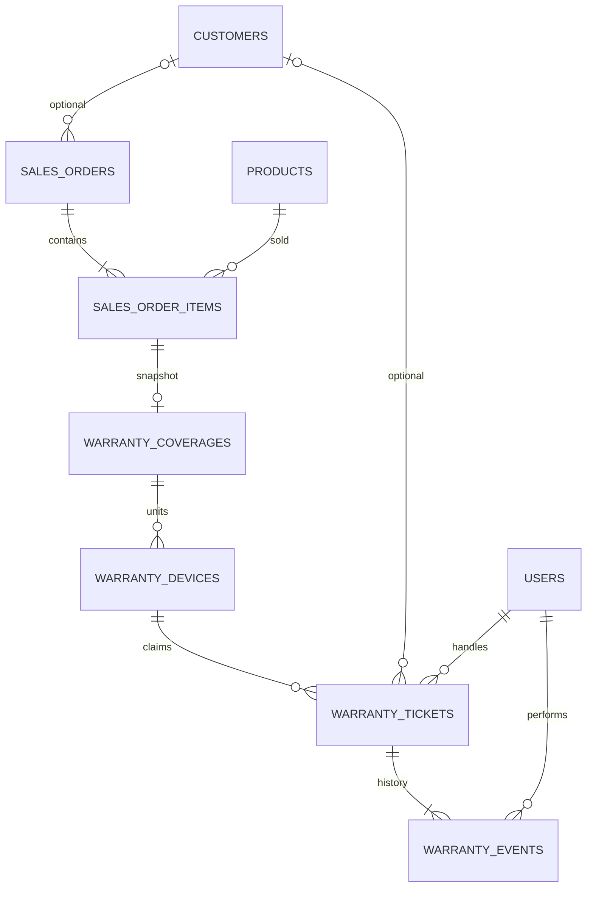

# Bảo hành và điều hướng Không gian kinh doanh

Phần bổ sung 5.2, giữ Flask/Jinja2/Bootstrap 5/MySQL/Docker. Không tích hợp AWS.

## Sử dụng

Đăng nhập tại http://localhost:8000/login bằng tài khoản hiện có. Trong Không
gian kinh doanh, mở **Hậu mãi → Tra cứu bảo hành**, tìm tên khách, điện thoại,
mã đơn, SKU hoặc serial đã ghi nhận. Chỉ trả giao dịch completed chưa bị hủy;
không tự liên kết khách hoặc suy đoán chính sách cho đơn cũ.

Chọn **Tiếp nhận**, chọn thiết bị thứ 1..số lượng của dòng bán, đối chiếu máy
và nhập serial/IMEI nếu có. Các thiết bị từng ghi nhận xuất hiện dưới dòng sản
phẩm (tối đa 10, serial khớp tìm kiếm được ưu tiên); có thể nhấn để điền đúng
vị trí/serial. Serial được trim/uppercase, tối đa 100 ký tự ASCII chữ/số/._/-.
Serial dùng UNIQUE toàn hệ thống, không được gắn cho hai thiết bị khác nhau.
Không bắt buộc serial; số thứ tự chỉ phân biệt đơn vị logic trong dòng bán,
nhân viên vẫn cần đối chiếu máy/chứng từ. Chưa kiểm tra IMEI với nhà sản xuất.

Phiếu nhận lưu lỗi khách báo, ngày nhận theo Việt Nam và ngày hẹn trả tùy chọn.
Ngày hẹn không trước ngày nhận. Tiếp nhận chưa phải chấp nhận miễn phí.

1. **Tiếp nhận → Đang xử lý**: ghi kết quả kiểm tra, xác nhận đã đối chiếu điều
   kiện chính sách. Backend yêu cầu còn hạn tại ngày nhận và đơn chưa hủy.
2. **Đang xử lý → Hoàn thành**: ghi kết quả xử lý.
3. **Tiếp nhận/Đang xử lý → Từ chối**: bắt buộc kết quả kiểm tra và lý do từ chối.
4. **Hoàn thành/Từ chối → Đã trả khách**: kết thúc phiếu, giải phóng thiết bị
   để có thể nhận yêu cầu mới. Phiếu từ chối vẫn giữ máy cho đến khi trả khách.

Không bỏ qua bước, mở lại phiếu đóng hoặc sửa/xóa lịch sử. Không đủ điều kiện
thời gian vẫn được ghi nhận yêu cầu và từ chối có lý do, không tự chấp nhận.
Không sửa kho, hoàn tiền, thay máy hoặc ghi chi phí sửa chữa trong module này.
Admin chỉ hủy đơn completed sau khi mọi phiếu bảo hành đã trả khách; lúc đó
quy tắc hoàn kho Stage 5 vẫn thực hiện như trước, không mất lịch sử bảo hành.

## Chính sách và dữ liệu cũ

Admin cấu hình bảo hành trong form sản phẩm: mặc định tắt, bật cần 1..120 tháng,
ghi chú tối đa 2000 ký tự. Staff giữ quyền catalog cũ nhưng không được thay ba
trường chính sách; backend chặn gửi trực tiếp, không chỉ ẩn trường nhập.

Khi tạo draft bán mới, chụp chính sách trong cùng transaction với giá snapshot.
Khi completed, ghi completed_at UTC và kích hoạt chính sách từ ngày hoàn tất
theo Asia/Ho_Chi_Minh. Cộng tháng lịch, chặn về ngày cuối tháng nếu cần: 31/01/2024
+ 1 tháng = 29/02/2024. Bảo hành còn hạn hết ngày expires_on. Kiểm tra miễn phí
vẫn cần kết quả kiểm tra thực tế; phần mềm không thay nhân viên kết luận lỗi.
Sửa/tắt bảo hành catalog hoặc inactive sản phẩm/khách không sửa quyền đã bán.

Đơn/draft cũ thiếu snapshot vẫn thiếu; không backfill từ catalog, order_date hoặc
updated_at. Đơn cũ completed được tra cứu nhưng cần **Admin xác minh**: nhập ngày
bắt đầu, số tháng, căn cứ và điều kiện lúc bán. Lưu một lần, có audit; không sửa
customer_id, ngày, tiền, trạng thái hoặc snapshot liên hệ đơn cũ. Đơn vãng lai
không cần customer_id. Hồ sơ khách chỉnh sửa không đổi liên hệ snapshot phiếu.

## Schema

Revision `w052_warranty` sau `c051_customers`: ba cột products, completed_at
nullable trên sales_orders và bốn bảng mới. Revision `w052_guards` làm chặt CHECK
NULL cho chính sách và cặp ngày; MySQL chấp nhận CHECK UNKNOWN nên cần IS NOT NULL.
15 bảng nghiệp vụ, 23 FK. Chi tiết cột/index: [DATABASE_SCHEMA.md](DATABASE_SCHEMA.md).



Coverage UNIQUE sale_item_id; device UNIQUE (coverage_id,unit_index), serial UNIQUE
nullable. Devices được tạo khi cần, không sinh hàng triệu dòng theo số lượng bán.
Ticket code UNIQUE. open_device_key generated STORED bằng device_id khi status
khác returned, NULL khi returned; UNIQUE chặn hai phiếu mở cho cùng thiết bị
ngay tại MySQL. FK RESTRICT; không có endpoint xóa/sửa trực tiếp coverage/device/
events. Các liên kết đơn và sản phẩm đi qua coverage → sale_item, tránh lưu FK
trùng và mâu thuẫn. Ticket lưu snapshot tên/SKU và liên hệ khi tiếp nhận.

## Quyền và riêng tư

| Thao tác | Admin | Staff |
| --- | --- | --- |
| Tra cứu completed toàn cửa hàng | Có | Projection tư vấn tối thiểu |
| Tạo phiếu từ dòng có chính sách | Có | Có |
| Danh sách/chi tiết/xử lý phiếu | Tất cả | Mình tạo hoặc được phân công |
| Chấp nhận/từ chối | Có | Chỉ phiếu trong phạm vi xử lý |
| Phân công, xác minh đơn cũ, cấu hình chính sách | Có | Không |

Staff tra cứu không nhận notes, audit, địa chỉ/email hoặc tổng tiền đơn. Không
có link mở đơn người khác; route đơn bán cũ tiếp tục chặn 404. Phiếu ngoài phạm
vi cũng 404. Xác minh/phân công/cấu hình bảo hành yêu cầu Admin ở backend.
Lịch sử xử lý chứa nội dung phục vụ phiếu được phép; audit chỉ ghi actor/action/
entity, không chép lỗi, ghi chú, liên hệ hoặc serial. Query/referrer không vào
Nginx/Gunicorn access log không lưu query/referrer; Nginx server-level override
tránh kế thừa thêm combined log của image. Giữ nguyên CSRF, session, rate limit và CSP.

## Transaction và đồng thời

Service dùng Session riêng và session.begin(). Thứ tự khóa: sales_order → coverage
→ device → ticket. Mọi request nhận/xử lý/hủy đơn đều cạnh tranh order lock trước.
Kiểm tra trạng thái sau SELECT FOR UPDATE; lỗi rollback device/ticket/event/audit.
Các đơn khác nhau tranh serial được UNIQUE DB phân xử, không dùng check-then-insert
không bảo vệ. Chuyển trạng thái nhận expected_status từ form, chặn thao tác cũ.
Tạo phiếu dùng ticket ký gắn actor/item/code và hết hạn 2 giờ, UNIQUE code chống
gửi lại; CSRF độc lập. Deadlock/timeout trả lỗi thân thiện, không retry mù.

## Sidebar

Native details/summary mở bằng click, Enter/Space, dùng được không JavaScript.
Nhóm route con mở từ Jinja; active link phân biệt tạo/danh sách/tra cứu. Khi
sidebar desktop thu gọn, click nhóm mở rộng sidebar rồi mở nhóm. Mobile giữ
Bootstrap offcanvas. Admin workspace không gộp với Business, chuyển không gian
giữ session/role. Profile vẫn là phần thật `/staff/dashboard#session`; JavaScript
đồng bộ active theo hash. Staff không thấy Nhập hàng và vẫn bị chặn backend.

## Kiểm thử và nâng cấp an toàn

```powershell
docker compose -f docker-compose.db-test.yml run --build --rm tests
.\.venv\Scripts\python.exe scripts/verify_warranty_migration.py
docker compose -f docker-compose.db-test.yml --profile ui up -d --wait ui-nginx
docker compose -f docker-compose.db-test.yml exec -T ui-nginx nginx -s reload
.\.venv\Scripts\python.exe scripts/verify_warranties_ui.py
.\.venv\Scripts\python.exe scripts/verify_document_links.py
```

Test chỉ dùng db-test/techflow_test hoặc schema test mới có guard, giữ volume và
lịch sử. Backend/browser chạy tuần tự. TECHFLOW_SCREENSHOT_DIR có thể trỏ vào
.docker-local để giữ ảnh regression ngoài thư mục minh chứng tài liệu.

Trước migration demo, chặn UI ghi bằng stop nginx; backup bằng
`scripts/verify_warranty_demo.py backup`, dump local/ignored và restore sang schema
db-test mới rồi so toàn bộ bảng/fingerprint. Chỉ sau kiểm chứng mới upgrade;
`compare` kiểm tra các cột gốc sau nâng cấp, gồm users/probe/catalog/customers và
giao dịch. DDL MySQL không rollback như DML; downgrade phá dữ liệu bị chặn.
Rollback app cần giữ schema bổ sung; recovery/forward fix phải được rà soát riêng.

Chưa có quản lý serial lúc giao bán, đổi serial/gộp thiết bị, bảo hành hãng tự
động, attachment, phí sửa chữa, đổi trả/hoàn tiền, linh kiện hoặc thông báo khách.
Chưa kiểm thử tải lớn/Safari/Firefox/thiết bị vật lý. Không có giảm giá, điểm,
membership hoặc triển khai cloud trong phạm vi này.
